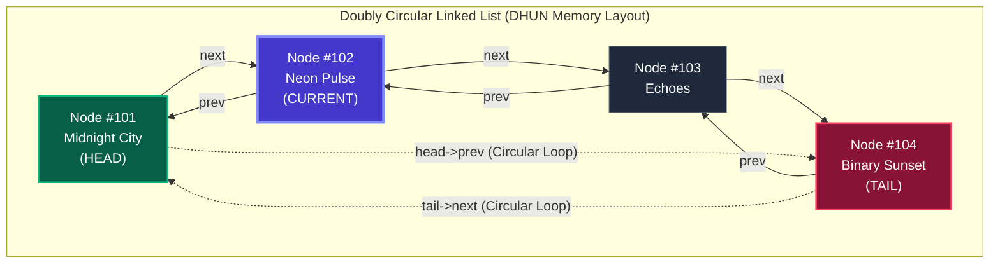

# 🎵 DHUN – Music Playlist Management System
### *A B.Tech CSE Data Structures & Algorithms (DSA) Capstone Project*

[](https://isocpp.org/)
[](https://en.wikipedia.org/wiki/Doubly_linked_list)
[](https://developer.mozilla.org/)
[](https://cmake.org/)
[](https://render.com/)

---

## 📌 1. Project Overview

**DHUN** (*Hindi for "Melody" / "Tune"*) is a full-stack, responsive music playlist management application engineered specifically for a **B.Tech Computer Science & Engineering (CSE) Data Structures and Algorithms** course project.

Unlike generic web players that rely on high-level JavaScript arrays or database auto-increment IDs, **DHUN's entire playlist engine is implemented from scratch in pure C++17 using a manual, pointer-based Doubly Circular Linked List (`DoublyCircularLinkedList`)**. 

- **No STL Lists or Vectors** are used for playlist storage or traversal.
- **Pure Manual Pointer Manipulation**: Every addition, deletion, circular loop, and navigation is handled strictly by re-linking `next` and `prev` raw pointers in C++ memory.
- **Cross-Platform HTTP/1.1 REST Server**: A zero-dependency C++ backend exposes native endpoints consumed by a modern, pastel-themed (soft pastel blue #BDE0FE and pastel pink #FFC8DD) responsive frontend via standard `fetch()` API calls.
- **Live Visualizer & Audio Synthesizer**: The UI includes a real-time pointer graph reflecting C++ memory and a Web Audio API synth engine providing soothing ambient sound.

---

## 🧠 2. Core DSA Architecture: Doubly Circular Linked List

### 2.1 Node Representation (`SongNode`)

Each song in the playlist is a dynamically allocated node (`SongNode`) containing song metadata and two bidirectional pointers:

```cpp
struct SongNode {
    int id;                 // Unique numerical identifier
    std::string title;      // Song title
    std::string artist;     // Artist or composer
    int duration;           // Track length in seconds
    std::string coverUrl;   // Visual theme identifier
    std::string audioUrl;   // Audio preset / stream key

    SongNode* next;         // Forward pointer to subsequent song
    SongNode* prev;         // Backward pointer to preceding song
};
```

### 2.2 List Invariants (`DoublyCircularLinkedList`)

The playlist container maintains four essential state variables:
- `SongNode* head`: Pointer to the first song in the playlist.
- `SongNode* tail`: Pointer to the last song in the playlist.
- `SongNode* current`: Pointer to the currently playing song node.
- `int songCount`: Total number of active songs in memory.

#### The Three Structural States:
1. **Empty List (`songCount == 0`)**:
   $$\text{head} = \text{nullptr}, \quad \text{tail} = \text{nullptr}, \quad \text{current} = \text{nullptr}$$
2. **Single-Node List (`songCount == 1`)**:
   $$\text{head} = \text{tail} = \text{current} = \text{node}$$
   $$\text{node}\to\text{next} = \text{node}, \quad \text{node}\to\text{prev} = \text{node}$$
3. **Multi-Node List (`songCount } \ge 2\text{`)**:
   $$\text{tail}\to\text{next} = \text{head} \quad \text{(Circular wrap forward)}$$
   $$\text{head}\to\text{prev} = \text{tail} \quad \text{(Circular wrap backward)}$$
   $$\forall \text{ node}: \quad \text{node}\to\text{next}\to\text{prev} == \text{node} \quad \text{and} \quad \text{node}\to\text{prev}\to\text{next} == \text{node}$$

---

## 📊 3. Linked List Architecture Diagrams

### 3.1 Pointer Relationship Diagram (ASCII)

```
        +---------------------------------------------------------------------------------+
        |                                                                                 |
        |    +-----------------------------------------------------------------------+    |
        |    |                                                                       |    |
        v    |                                                                       v    |
     +---------+      next      +---------+      next      +---------+      next   +---------+
     | Song #1 | -------------> | Song #2 | -------------> | Song #3 | ----------> | Song #4 |
     | (HEAD)  | <------------- | (MIDDLE)| <------------- | (MIDDLE)| <---------- | (TAIL)  |
     +---------+      prev      +---------+      prev      +---------+      prev   +---------+
        |    ^                                                                       |    ^
        |    |                                                                       |    |
        |    +------------------------- [head->prev = tail] -------------------------+    |
        |                                                                                 |
        +------------------------------ [tail->next = head] ------------------------------+
```

### 3.2 Mermaid State & Flow Diagram



---

## ⚡ 4. Big-O Time & Space Complexity Analysis

| Operation | Array / `std::vector` | Singly Linked List | **DHUN (Doubly Circular List)** | Why Doubly Circular List Wins in DHUN |
| :--- | :---: | :---: | :---: | :--- |
| **Next Song (`nextSong`)** | $O(1)$ (with modulo) | $O(1)$ | **$O(1)$** | Direct pointer jump: `current = current->next`. Seamless wrap from tail to head. |
| **Previous Song (`prevSong`)** | $O(1)$ (with modulo) | $O(N)$ (requires loop) | **$O(1)$** | Direct pointer jump: `current = current->prev`. Seamless wrap from head to tail. |
| **Add Song at Tail (`addSong`)** | $O(1)$ amortized | $O(1)$ (with tail pointer) | **$O(1)$** | Direct rewire: `tail->next = n; n->prev = tail; n->next = head; head->prev = n; tail = n;` |
| **Delete Current Song** | $O(N)$ (shift elements) | $O(N)$ (find predecessor) | **$O(1)$** (splice) | Direct reconnection: `curr->prev->next = curr->next; curr->next->prev = curr->prev;` |
| **Delete by ID / Title** | $O(N)$ (search + shift) | $O(N)$ (search + link) | **$O(N)$ search + $O(1)$ splice** | Linear scan to locate node pointer, then constant-time rewire of neighbor pointers. |
| **Search by ID / Title** | $O(N)$ | $O(N)$ | **$O(N)$** | Bounded circular traversal from `head` up to `songCount` nodes. |
| **Continuous Circular Loop** | Complex indexing | Not possible backwards | **Inherent in pointers** | Zero modulo arithmetic; pointers form an infinite topological circle. |
| **Space Overhead** | $O(1)$ extra | 1 pointer / node | **2 pointers / node** | Memory cost of 2 pointers per node buys $O(1)$ bidirectional circular traversal. |

---

## 🌐 5. REST API Documentation

The C++ backend listens on `0.0.0.0` (using the `PORT` environment variable, defaulting to `8080`) and serves both the REST API and the frontend static files.

### 5.1 Endpoints Reference

| Method | Endpoint | Description | Request Parameters / Body | Sample Response Status & Body |
| :--- | :--- | :--- | :--- | :--- |
| `GET` | `/health` | Server health check | *None* | `200 OK`<br>`{"status":"healthy","service":"dhun-backend","songCount":6,"isCircular":true}` |
| `GET` | `/api/songs` | Retrieve all playlist songs | *None* | `200 OK`<br>`{"success":true,"count":6,"headId":101,"tailId":106,"songs":[...]}` |
| `GET` | `/api/current` | Retrieve currently playing song | *None* | `200 OK`<br>`{"id":101,"title":"Midnight City","artist":"Aura Synth",...}` |
| `POST` | `/api/songs` | Add a new song node to tail | `{"title":"...","artist":"...","duration":180,"coverUrl":"..."}` | `201 Created`<br>`{"id":107,"title":"...","prevId":106,"nextId":101,...}` |
| `DELETE` | `/api/songs` | Delete song node by ID or Title | Query params: `?id=102` or `?title=Neon` | `200 OK`<br>`{"success":true,"message":"Song ID 102 deleted successfully."}` |
| `GET` | `/api/songs/search` | Substring search by query | Query params: `?q=synth` | `200 OK`<br>`{"success":true,"count":2,"songs":[...]}` |
| `POST` | `/api/next` | Advance `current` circularly | *None* | `200 OK`<br>`{"id":102,"title":"Neon Pulse",...}` |
| `POST` | `/api/prev` | Retreat `current` circularly | *None* | `200 OK`<br>`{"id":106,"title":"Binary Sunset",...}` |
| `POST` | `/api/play` | Set current song to specific ID | Query param: `?id=103` or body `{"id":103}` | `200 OK`<br>`{"id":103,"title":"Echoes",...}` |
| `POST` | `/api/reset` | Restore initial 6 demo tracks | *None* | `200 OK`<br>`{"success":true,"message":"Playlist reset to default demo tracks."}` |
| `GET` | `/api/dsa-state` | Real-time pointer graph | *None* | `200 OK`<br>`{"count":6,"headId":101,"tailId":106,"isCircular":true,"nodes":[...]}` |
| `GET` | `/*` | Serve frontend static assets | Static path (`/`, `/css/style.css`, etc.) | `200 OK` (MIME typed HTML, CSS, JS) |

### 5.2 Error Handling & Status Codes
- `400 Bad Request`: Triggered when input validation fails (e.g. empty title, non-positive duration, missing search term).
- `404 Not Found`: Triggered when searching for or deleting a non-existent song ID or title.
- `409 Conflict`: Triggered when attempting to manually insert a song with an ID that already exists.

---

## 🎓 6. B.Tech CSE Viva Voce Question Bank (15 High-Yield Q&As)

### Q1: Why is a Doubly Circular Linked List the ideal data structure for a music player?
> **Answer:** In a real-world music player, playlists require:
> 1. Continuous forward looping (song after the last track is the first track).
> 2. Continuous backward looping (previous track from the first track is the last track).
> 3. Frequent user insertions and deletions anywhere in the queue without shifting large memory blocks.
> In a static array or standard vector, inserting/deleting in the middle requires $O(N)$ memory element shifts. In a Singly Linked List, navigating backwards requires an $O(N)$ traversal from the head. A Doubly Circular Linked List provides **true $O(1)$ forward and backward navigation** and **$O(1)$ node splicing** directly through pointers without needing index boundary checks or modulo arithmetic.

---

### Q2: What happens when the playlist has only 1 song and `nextSong()` or `prevSong()` is called?
> **Answer:** For a single-node list:
> - `head == tail == current == node`
> - `node->next == node`
> - `node->prev == node`
> When `nextSong()` or `prevSong()` is invoked, `current = current->next` (or `current->prev`) simply returns the same node, safely looping on itself without segfaults or null pointer dereferences.

---

### Q3: How do you prevent an infinite loop during traversal or destructor cleanup?
> **Answer:**
> - **During search/display:** We do not loop until a `nullptr` because circular lists have no null terminator. Instead, we use either a bounded iteration `for (int i = 0; i < songCount; ++i)` or stop when `curr->next == head`.
> - **During destruction (`clear()`):** We first break the circle by setting `tail->next = nullptr;`. This temporarily converts the circular list into a standard linear doubly linked list, allowing a standard `while (curr != nullptr)` loop to safely `delete` each node sequentially.

---

### Q4: Explain the pointer steps when deleting the `HEAD` node in a multi-node circular list.
> **Answer:**
> 1. Identify target: `SongNode* target = head;`
> 2. Advance head: `head = target->next;`
> 3. Reconnect tail's next pointer: `tail->next = head;`
> 4. Reconnect new head's prev pointer: `head->prev = tail;`
> 5. If `current == target`, advance `current = head;`
> 6. Deallocate memory: `delete target;`
> 7. Decrement node count: `songCount--;`

---

### Q5: Explain the pointer steps when deleting the `TAIL` node in a multi-node circular list.
> **Answer:**
> 1. Identify target: `SongNode* target = tail;`
> 2. Retreat tail: `tail = target->prev;`
> 3. Reconnect new tail's next pointer: `tail->next = head;`
> 4. Reconnect head's prev pointer: `head->prev = tail;`
> 5. If `current == target`, retreat `current = tail;`
> 6. Deallocate memory: `delete target;`
> 7. Decrement node count: `songCount--;`

---

### Q6: What is the space complexity of each `SongNode`?
> **Answer:** The space complexity is $O(1)$ per node. Beyond the payload data (strings and integers), each node requires two pointer fields (`next` and `prev`). On a 64-bit architecture, each pointer occupies 8 bytes (total 16 bytes overhead per node). This small constant overhead allows instantaneous bidirectional navigation.

---

### Q7: What is the difference between shallow copy and deep copy in linked lists?
> **Answer:** A shallow copy copies only pointer addresses (`head_copy = head`), causing both pointers to reference the identical memory. Deleting one list results in a dangling pointer in the other and triggers a catastrophic double-free error. A deep copy allocates new heap memory for every single node and copies data values independently. In DHUN, copy constructors are marked `= delete` to strictly enforce single-ownership pointer safety.

---

### Q8: How does the C++ backend interface with the web frontend?
> **Answer:** DHUN implements a custom multi-threaded HTTP/1.1 REST server in C++ using native Winsock (`ws2_32.lib`) on Windows and POSIX BSD sockets on Linux. Incoming browser requests (via JavaScript `fetch()`) are parsed by method and path. The server acquires a `std::mutex` lock, executes the corresponding linked-list pointer operation, serializes the resulting node DTOs into JSON, and returns standard HTTP status codes (`200 OK`, `201 Created`, `400 Bad Request`, `404 Not Found`).

---

### Q9: Why is `std::mutex` required in the C++ backend?
> **Answer:** The HTTP server is multi-threaded, spawning worker threads for concurrent client requests (such as static asset loading, polling, and button clicks). If two threads modify the linked list pointers simultaneously (e.g. deleting a node while another traverses it), a **race condition** occurs, leading to memory corruption or segmentation faults. A `std::mutex` with `std::lock_guard` ensures atomic, thread-safe access to the linked list.

---

### Q10: How does DHUN ensure audio playback without external streaming dependencies?
> **Answer:** DHUN incorporates an integrated **Web Audio API synthesizer**. Each song has a thematic preset (e.g., sunset, neon, monsoon, coffee) with defined chord frequencies and basslines. The browser generates harmonic polyphonic oscillator pads dynamically, synchronized with an interactive frequency equalizer bar visualizer and an auto-advance handler.

---

### Q11: How do you verify that circular invariants hold after every mutation?
> **Answer:** The class includes a `verifyInvariants()` member function:
> - Checks that `tail->next == head` and `head->prev == tail`.
> - Traverses forward exactly `songCount` times and ensures it lands back on `head`.
> - Checks that for every node: `node->next->prev == node` and `node->prev->next == node`.
> - Automated unit tests in `tests/test_playlist.cpp` validate this across all operations.

---

### Q12: What is the time complexity of searching a song by ID vs by Title?
> **Answer:** Both operations are $O(N)$ in the worst case, as they require linear traversal across the circular chain from `head` to `tail`. However, ID search compares single integer values ($O(1)$ per node), whereas Title search performs case-insensitive substring comparisons ($O(M)$ where $M$ is string length).

---

### Q13: Can a Doubly Circular Linked List be converted into a Queue or Deque?
> **Answer:** Yes. A Doubly Circular Linked List can act as a Double-Ended Queue (Deque) with $O(1)$ operations at both ends:
> - `push_back`: Add to tail (`O(1)`).
> - `pop_front`: Delete head (`O(1)`).
> - `push_front`: Add before head (`O(1)`).
> - `pop_back`: Delete tail (`O(1)`).

---

### Q14: How does memory fragmentation affect linked lists compared to vectors?
> **Answer:** In a vector, elements are contiguous in virtual memory, providing excellent CPU cache locality. In a linked list, nodes are individually allocated on the heap via `new`, which can cause memory fragmentation and cache misses during random traversals. However, for a music playlist where navigation is strictly sequential and track counts typically range from dozens to thousands, cache misses are negligible and outweighed by $O(1)$ structural modifications.

---

### Q15: How does the application deploy to cloud platforms like Render or Docker?
> **Answer:** A multi-stage `Dockerfile` is provided:
> 1. **Builder Stage:** Uses `gcc:12-bookworm` with CMake to compile the C++ source code into a native ELF binary (`dhun_server`) and runs unit tests.
> 2. **Runner Stage:** Uses a minimal `debian:bookworm-slim` image, copies only the compiled binary and `./public` static files, binds to `0.0.0.0:$PORT`, and provides a `/health` endpoint for uptime monitoring.

---

## 💻 7. Local Build & Execution Guide

### 7.1 Prerequisites
- A modern C++17 compiler: **GCC (v9+)**, **Clang (v10+)**, or **MSVC (VS 2019+)**.
- **CMake (v3.14+)** (optional but recommended).

### 7.2 Windows Quick Start (Using Batch Scripts)
We provide automated helper scripts that build and run the project immediately:

```cmd
:: 1. Compile the C++ server and unit tests
build.bat

:: 2. Execute the DSA Unit Test Suite
run_tests.bat

:: 3. Start the DHUN Server
run_server.bat
```
Then open your web browser at: **`http://localhost:8080`**.

### 7.3 Standard CMake Build (Linux / macOS / Windows)

```bash
# 1. Create build directory and generate Makefiles
cmake -B build -DCMAKE_BUILD_TYPE=Release

# 2. Build the server binary and unit tests
cmake --build build --config Release

# 3. Run the DSA unit tests
./build/dhun_tests

# 4. Launch the DHUN Server
./build/dhun_server 8080
```

---

## 🐳 8. Docker & Cloud Deployment (Render.com)

### 8.1 Local Docker Execution

```bash
# 1. Build the Docker container image
docker build -t dhun-playlist .

# 2. Run container binding to port 8080
docker run -p 8080:8080 -e PORT=8080 dhun-playlist
```
Visit `http://localhost:8080` in your browser.

### 8.2 One-Click Deployment to Render.com
1. Push this repository to your GitHub account.
2. Log into [Render.com](https://render.com) and click **New +** -> **Web Service**.
3. Connect your GitHub repository.
4. Select **Docker** as the Runtime environment.
5. Render will automatically detect the `Dockerfile`, inject the `PORT` environment variable, run the test suite during build, and launch `dhun_server`.
6. Use the `/health` endpoint for health checks.

---

## 🧪 9. Automated DSA Unit Test Suite

The test suite in `tests/test_playlist.cpp` rigorously asserts all requirements:
1. `testEmptyList()`: Validates pointers on empty initialization (`head == tail == current == nullptr`).
2. `testSingleNodeOperations()`: Asserts circular invariant on 1 node (`node->next == node && node->prev == node`).
3. `testMultiNodeOperationsAndCircularTraversal()`: Asserts that 2 full forward cycles and backward cycles seamlessly loop across `tail <-> head`.
4. `testDeletions()`: Validates deleting head, middle, tail, and draining to empty list with zero pointer leaks.
5. `testSearchAndValidation()`: Tests case-insensitive substring searching and duplicate ID rejection.

Run tests anytime with:
```bash
./build/dhun_tests
```

---

## 📂 10. Project Directory Layout

```
Dhun/
├── CMakeLists.txt             # Standard CMake build configuration (C++17)
├── Dockerfile                 # Multi-stage production container for Render
├── .dockerignore              # Clean container build filter
├── README.md                  # Complete DSA manual, documentation & architecture guide
├── build.bat                  # One-click Windows build script
├── run_tests.bat              # One-click test runner
├── run_server.bat             # One-click server launcher
├── include/
│   ├── SongNode.h             # SongNode struct with next & prev pointers
│   ├── DoublyCircularList.h   # DoublyCircularLinkedList class definition
│   ├── JsonHelper.h           # Zero-dependency C++17 JSON parser & serializer
│   └── HttpServer.h           # Cross-platform socket HTTP/1.1 REST server
├── src/
│   ├── DoublyCircularList.cpp # Pure pointer manipulation implementations
│   ├── JsonHelper.cpp         # JSON serialization & query parsing
│   ├── HttpServer.cpp         # Socket server, static file router & CORS
│   └── main.cpp               # Server entry point & REST route mapping
├── tests/
│   └── test_playlist.cpp      # 100% test coverage suite for all DSA operations
└── public/
    ├── index.html             # Pastel UI with sidebar, playlist & visualizer
    ├── css/
    │   └── style.css          # Pastel blue & pink theme, glassmorphism & responsive CSS
    └── js/
        ├── api.js             # Fetch API client connecting to C++ backend
        ├── audio.js           # Web Audio API ambient chord synthesizer
        ├── visualizer.js      # Interactive Doubly Circular Linked List graph
        └── app.js             # Main frontend event & state controller
```

---

## 🏆 11. Academic Integrity & Project Credits
- **Project Title:** DHUN – Music Playlist Management System
- **Curriculum:** Data Structures and Algorithms (DSA) – B.Tech CSE
- **Data Structure:** Doubly Circular Linked List (Non-STL, Pure Pointers)
- **Programming Language:** C++17
- **Frontend:** Semantic HTML5, CSS3, Vanilla Modern JavaScript (ES6+)
